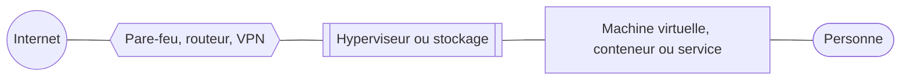

# Homelab — architecture et sécurité

Un homelab devenu une petite plateforme d'hébergement : il fait tourner des sites web en production, avec une
posture de sécurité et de supervision inspirée des infrastructures d'entreprise.

Ce dépôt décrit **l'architecture et les mécanismes**. Il ne contient volontairement ni adresse, ni nom de machine ou de
domaine, ni version, ni horaire, ni état détaillé : de quoi comprendre l'approche, rien qui aiderait à attaquer.

Les schémas sont écrits en [Mermaid](https://mermaid.js.org/) : GitHub les affiche directement.

## En bref

- **Des hyperviseurs Proxmox** sans cluster, sur x86_64 et sur Raspberry Pi (PXVirt), pour une vingtaine de VM et de
  conteneurs LXC.
- **Un pare-feu central** (OPNsense) et des zones étanches, en refus par défaut.
- **Une seule entrée pour les sites** : un reverse proxy avec pare-feu applicatif (WAF).
- **Administration par Teleport**, joignable seulement à travers un VPN, avec double authentification.
- **Identité des clients** : un fournisseur unique (OpenID), clés d'accès (passkeys), session liée au réseau du client.
- **Pas d'accès internet direct par défaut** : un dépôt local approvisionne toutes les machines.
- **Détection** : Wazuh (SIEM), CrowdSec (décisions appliquées par le pare-feu central), WAF Coraza avec l'OWASP CRS, fichiers-pièges sur les machines exposées.
- **Supervision** : Prometheus, Alertmanager, Grafana, sondes externes réelles.
- **CI/CD** : Gitea Actions, un seul workflow pour tous les projets, runner sans privilège.
- **Mises à jour automatiques** par anneaux, avec redémarrages contrôlés.
- **Sauvegardes tirées** par le stockage, jamais poussées par la source.

## Sommaire

| Page | Contenu |
|---|---|
| [Architecture](docs/01-architecture.md) | L'infra en un schéma, et les principes qui la tiennent |
| [Réseau](docs/02-reseau.md) | Zones, pare-feu central, DNS cloisonné, flux communs |
| [Accès d'administration](docs/03-acces.md) | VPN et Teleport : certificats courts, tunnels sortants |
| [Sécurité](docs/04-securite.md) | Défense en profondeur, détection, durcissement, secrets |
| [Approvisionnement](docs/05-approvisionnement.md) | Le dépôt local : paquets, fichiers vérifiés, images |
| [CI/CD](docs/06-ci-cd.md) | Gitea Actions : trois branches, trois destinations, des garde-fous |
| [Sauvegardes](docs/07-sauvegardes.md) | Le modèle « tiré, jamais poussé » |
| [Certificats](docs/08-certificats.md) | Un relais de signature : la clé privée ne quitte jamais sa machine |
| [Mises à jour](docs/09-mises-a-jour.md) | Anneaux, redémarrages contrôlés, retour arrière automatique |
| [Supervision](docs/10-supervision.md) | Métriques, sondes externes, alertes, SIEM |
| [Retours d'expérience](docs/11-retours-d-experience.md) | Ce que les pannes réelles ont appris |

## Briques

| Domaine | Outils |
|---|---|
| Virtualisation | Proxmox VE, PXVirt (Proxmox pour ARM), conteneurs LXC |
| Réseau et périmètre | OPNsense, WireGuard, Unbound |
| Accès | Teleport (édition Community) |
| Identité | Authentik (OpenID), clés d'accès (WebAuthn) |
| Web | Traefik, Coraza et OWASP CRS, nginx durci |
| Détection | Wazuh, CrowdSec |
| Supervision | Prometheus, Alertmanager, Grafana, blackbox_exporter |
| CI/CD | Gitea Actions, Docker sans root, BuildKit, QEMU |
| Approvisionnement | apt-cacher-ng, Zot, relais de fichiers vérifiés |
| Certificats | Let's Encrypt, défi DNS-01 |

## Légende des schémas

- Flèche pleine : flux autorisé, dans le sens où la connexion s'ouvre.
- Flèche épaisse : chemin du code ou des données.
- Flèche pointillée : flux conditionnel ou occasionnel.

## Méthode

- **Diagnostiquer avant de corriger** : la cause est prouvée (trace système, journal, comparaison d'empreintes) avant
  tout correctif.
- **Tester pour de vrai** : redémarrage à froid, panne simulée, restauration de sauvegarde. Plusieurs bugs n'étaient
  visibles qu'ainsi.
- **Toute modification risquée a un retour arrière automatique** (réseau, pare-feu, mises à jour) et une sauvegarde de
  l'état précédent.
- **Tout est documenté au fil de l'eau**, décisions et pièges compris.
