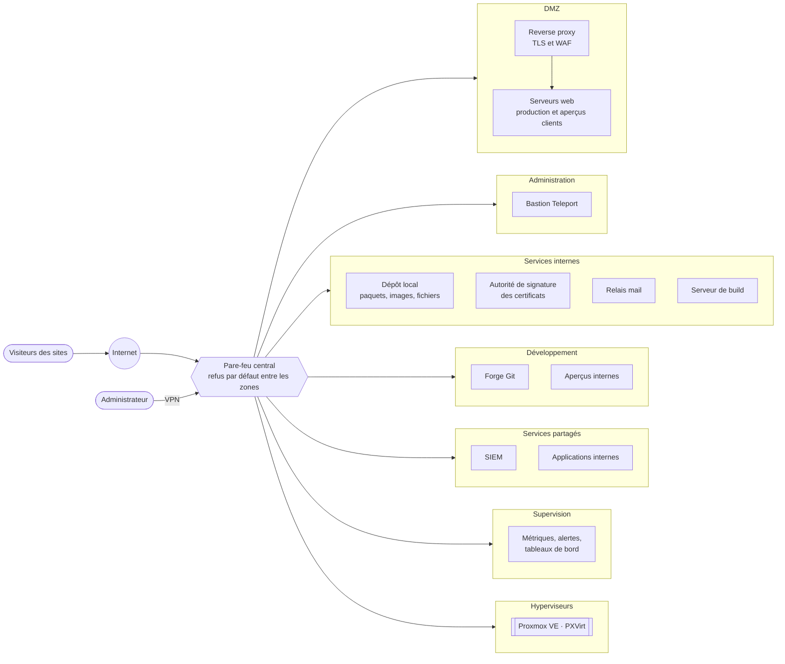

# Architecture

[← Sommaire](../README.md)

L'infra tient en une idée : **un pare-feu central, des zones étanches, et un minimum de portes**. Tout le trafic entre
zones passe par le pare-feu, en refus par défaut ; chaque flux autorisé est une exception explicite (source,
destination, service).

## Les principes

| Principe | Mise en œuvre |
|---|---|
| Une seule entrée pour les sites | Le reverse proxy (TLS et WAF) reçoit tout le trafic des sites ; les serveurs web ne sont jamais exposés directement. |
| Une administration hors d'internet | Teleport, joignable seulement par le VPN. Chaque serveur ouvre lui-même un tunnel sortant vers le bastion : l'administration ne demande aucun port entrant. |
| Un seul point d'approvisionnement | Le dépôt local fournit paquets, images et fichiers vérifiés ; les machines n'ont pas d'accès internet direct par défaut. |
| Une seule autorité de signature | Une machine détient les jetons de l'API DNS ; les autres lui envoient une demande de signature, et la clé privée ne quitte jamais sa machine. |
| Un seul relais mail | Il détient les identifiants d'envoi ; applications et alertes passent toutes par lui. |
| Des sauvegardes tirées | Le stockage va chercher les copies : une machine compromise ne peut ni lire, ni modifier, ni effacer ses propres sauvegardes. |

Chaque principe a sa page, à commencer par le [réseau](02-reseau.md).
