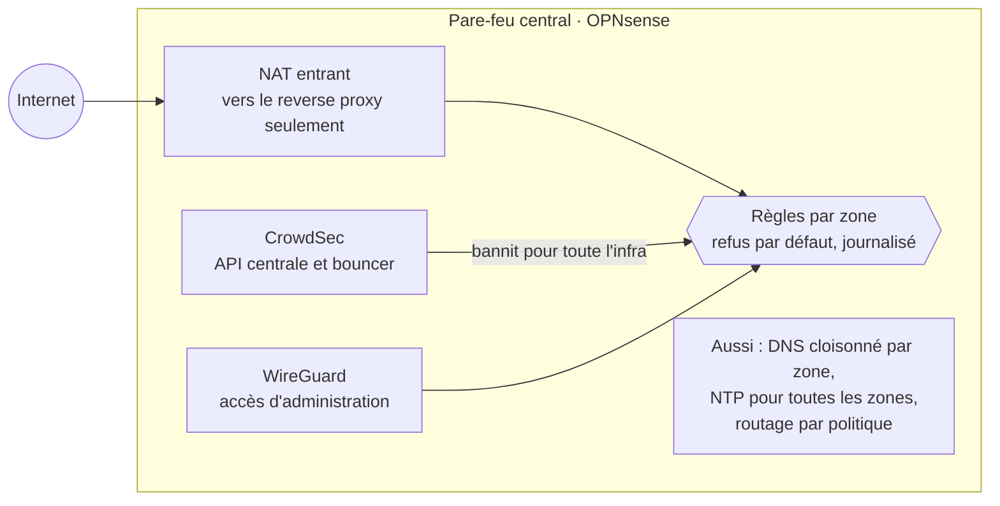
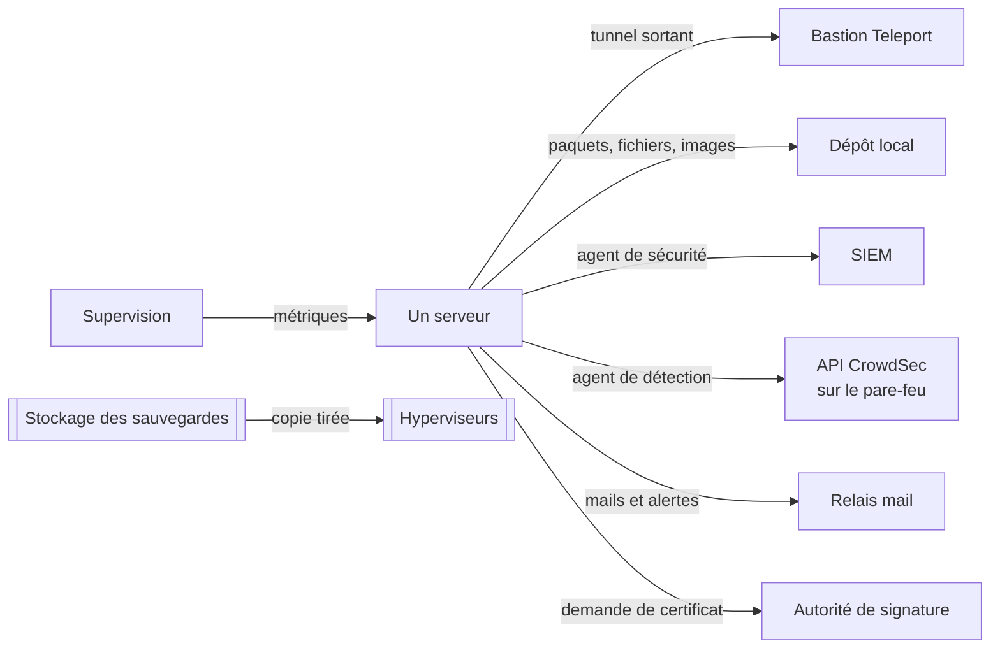

# Réseau

[← Sommaire](../README.md)

## Des zones étanches

Chaque zone a son propre VLAN et un sous-réseau dimensionné au plus juste : une zone n'a que la place de ce qu'elle
héberge.

| Zone | Rôle |
|---|---|
| Maison | appareils personnels |
| Invités | Wi-Fi invité, isolé de tout le reste |
| DMZ | tout ce qui reçoit du trafic d'internet : reverse proxy, serveurs web, aperçus clients |
| Administration | le bastion Teleport |
| Services internes | ce dont toutes les machines ont besoin : dépôt local, signature des certificats, relais mail, build |
| Développement | forge Git, aperçus internes, machine de développement |
| Services partagés | SIEM et applications internes |
| Supervision | métriques, alertes, tableaux de bord |
| Hyperviseurs | les hôtes de virtualisation |

## Le pare-feu central

- **Refus par défaut** entre zones : chaque flux autorisé est une règle explicite (source, destination, service) ; tout
  le reste est bloqué et journalisé.
- **CrowdSec** : les machines ne font que détecter. L'API centrale et le bouncer sont sur le pare-feu : une décision
  prise sur une machine bloque l'adresse pour toute l'infra.
- **DNS cloisonné** : les zones les plus exposées ne résolvent pas les noms internes. Leurs machines ne connaissent que
  les quelques services dont elles ont besoin, par un fichier `hosts` figé.
- **Routage par politique** : la supervision sonde les sites publics « de l'extérieur », à travers un tunnel VPN
  dédié, sans recevoir d'accès internet général (voir [supervision](10-supervision.md)).

## Les flux communs

Une machine ne joint que les quelques services dont tout le monde a besoin :

Les flux propres à un service (CI/CD, sauvegardes, certificats) sont décrits dans leur page.

## Principes réseau

- **Jamais de ping pour tester une connectivité** : ICMP est coupé presque partout. Les tests se font en TCP ou au
  niveau applicatif, ce qui vérifie vraiment ce dont le service a besoin.
- **Une adresse fixe pour tout ce dont une règle dépend**, jusque dans les conteneurs Docker : une adresse attribuée au
  démarrage peut changer et inverser silencieusement une règle de pare-feu.
- **Un VLAN par carte d'invité** côté hyperviseur, et un pare-feu local sur les machines sensibles, en plus du pare-feu
  central.
