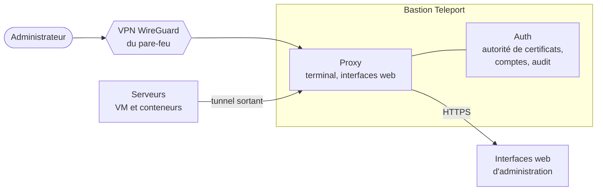
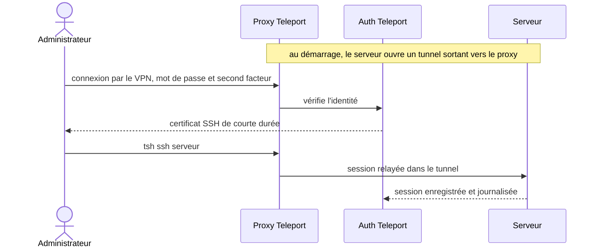

# Accès d'administration

[← Sommaire](../README.md)

**Les serveurs s'administrent par Teleport**, joignable seulement à travers le VPN du pare-feu : en dehors du VPN,
rien de ce qui sert à administrer l'infra n'est joignable depuis internet.

Teleport (édition Community) a été préféré à JumpServer : un seul binaire, et des certificats de courte durée liés à
l'identité plutôt qu'un coffre de secrets à héberger, là où JumpServer demande 4 cœurs, 8 Go de RAM et 100 Go de
disque au minimum.

## Comment se passe une connexion

- **L'administration n'ouvre aucun port entrant** : chaque serveur ouvre lui-même un tunnel sortant vers le proxy, en
  épinglant l'autorité de certificats de Teleport. Chaque serveur reçoit son propre jeton d'enrôlement, supprimé dès que
  le serveur apparaît.
- **Pas de clé SSH personnelle à distribuer ni à révoquer** : l'accès par Teleport repose sur des certificats de courte
  durée, délivrés après double authentification.
- **Sessions enregistrées** et journalisées.
- **Interfaces web** : chaque interface d'administration a sa propre adresse derrière Teleport, couverte par un
  certificat joker ; les nouvelles se déclarent dynamiquement, sans redémarrer le bastion.
- **Les mises à jour de nuit vérifient, avant tout redémarrage, que la machine restera joignable par Teleport** :
  service activé au démarrage, nom du bastion bien résolu, fichier `hosts` protégé contre cloud-init. Sinon, le
  redémarrage est annulé et une alerte part (voir [mises à jour](09-mises-a-jour.md)).
