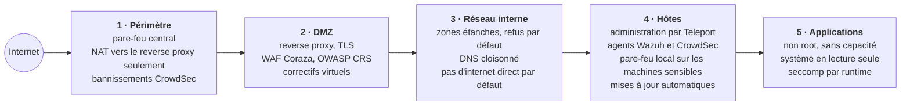
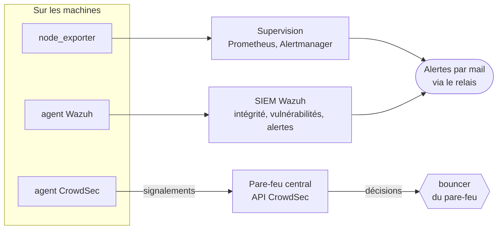

# Sécurité

[← Sommaire](../README.md)

Défense en profondeur : chaque couche suppose que la précédente peut céder.

La détection tourne en boucle au-dessus de ces couches :

## Périmètre et DMZ

- **Une seule machine reçoit le trafic des sites** : le reverse proxy (Traefik), avec un pare-feu web Coraza et l'OWASP
  Core Rule Set en sidecar. Les serveurs web derrière lui ne sont jamais exposés directement.
- **Correctifs virtuels** : un fichier de règles maison, chargé à part, permet de bloquer une attaque connue sans
  reconstruire l'image.
- **CrowdSec** : les machines ne font que détecter ; l'API et le bouncer sont sur le pare-feu central, qui bloque
  l'adresse pour toute l'infra.

## Hôtes

- **Administration par Teleport**, avec double authentification (voir [accès](03-acces.md)).
- **Pare-feu local** sur les machines sensibles, en plus du pare-feu central : par exemple, le relais de fichiers du
  dépôt local n'accepte qu'une liste d'adresses, et l'autorité de signature n'accepte que les machines autorisées à
  faire signer.
- **Wazuh** : des agents sur les machines, surveillance d'intégrité en temps réel des fichiers sensibles, détection
  des vulnérabilités, alertes par mail.
- **Comptes de service à commande forcée** : sauvegardes, déploiements et signatures de certificats passent par des
  comptes dédiés dont la clé SSH ne peut lancer qu'un seul script (`restrict`, `from=`, `command=`), avec `sudo` limité
  à ce script.
- **Hôtes réduits à l'essentiel** : résolution de noms multicast (LLMNR) coupée, réglages noyau de durcissement réseau
  (anti-usurpation, pas de redirections ICMP, traces des paquets anormaux), connexion SSH par clé seulement, et aucune
  sortie internet là où elle n'est pas nécessaire.

## Conteneurs et services

Les images maison appliquent par défaut :

- utilisateur non root dès le démarrage ;
- `cap_drop: ALL`, et seulement le strict nécessaire en retour (par exemple `NET_BIND_SERVICE`) ;
- système de fichiers en lecture seule, `tmpfs` en `mode=1777` pour ce qui doit être écrit ;
- **un profil seccomp propre à chaque famille de runtime** : un profil prévu pour nginx, réutilisé pour un binaire Go,
  bloquait `getpeername` et cassait l'envoi de mails ;
- limites de mémoire et de processus ;
- **adresse IP fixe** dès qu'une règle de pare-feu en dépend ;
- images `FROM scratch` ou nginx statique quand c'est possible.

Les services installés nativement suivent la même idée avec systemd : compte dédié, une seule capacité si besoin,
`NoNewPrivileges`, système en lecture seule sauf les données (`ProtectSystem=strict`), `/tmp` privé.

## Identité des clients

Les applications destinées aux clients ne gèrent pas elles-mêmes les mots de passe : elles s'appuient sur un
**fournisseur d'identité unique** (Authentik), réutilisable d'un projet à l'autre.

- **Clés d'accès (passkeys)** : l'authentification repose sur WebAuthn, lié au vrai domaine. Une fausse page de
  connexion ne peut pas rejouer une clé d'accès — l'hameçonnage classique ne prend pas.
- **Session liée au réseau du client** : le cookie de session est attaché à l'opérateur d'origine. Rejoué depuis un
  autre fournisseur d'accès, il est refusé — un vol de cookie seul ne suffit plus.
- **Chaque application vérifie elle-même le jeton** : elle fait sa propre connexion OpenID et contrôle la signature du
  jeton (clé publique annoncée par le fournisseur, algorithmes faibles refusés, émetteur et destinataire vérifiés).
  Elle ne fait jamais confiance à un en-tête injecté par le proxy, qui pourrait être forgé si on atteignait
  l'application par un autre chemin.
- **Fournisseur durci et hors de portée** : le fournisseur d'identité suit le même durcissement que les autres
  conteneurs ; il n'écoute qu'en local, et sa console d'administration n'est joignable qu'à travers le bastion, jamais
  depuis internet (voir [accès](03-acces.md)).

## Leurres

Des **fichiers-pièges** (faux identifiants, fausse sauvegarde, fausse clé) sont posés sur les machines exposées. Ils ne
servent qu'à être surveillés : toute lecture déclenche une alerte, avec le programme et le compte qui l'a ouverte.
C'est un signal d'intrusion à très faible bruit — personne n'a de raison légitime d'y toucher (voir
[supervision](10-supervision.md)).

## Chaîne d'approvisionnement

- **Tout passe par le dépôt local** : paquets APT, fichiers, images de conteneurs (voir
  [approvisionnement](05-approvisionnement.md)).
- **Empreintes vérifiées** pour tout ce qui est téléchargé hors APT ; APT vérifie déjà ses signatures, ce qui a permis
  de repérer un cache corrompu sans rien installer de faux.
- **Releases tierces vérifiées** contre la somme publiée par l'éditeur, jamais choisies sur leur seul nom de fichier.

## Secrets

- **Un détenteur par secret** : les jetons de l'API DNS ne sont que sur l'autorité de signature, les identifiants
  d'envoi de mail que sur le relais.
- **Jamais de secret en argument de commande ni dans un journal** : saisie masquée, passage par l'entrée standard.
- **Les clés privées des certificats ne quittent jamais leur machine** : seule la demande de signature circule (voir
  [certificats](08-certificats.md)).
