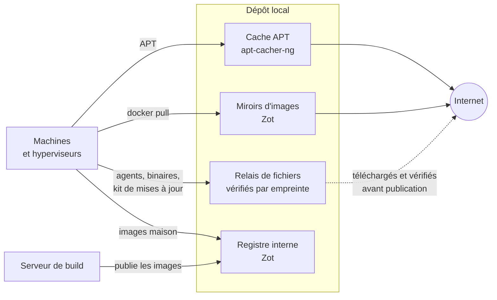

# Approvisionnement

[← Sommaire](../README.md)

Par défaut, les machines n'ont pas d'accès direct à internet. **Un dépôt local** leur fournit tout ce dont elles ont
besoin : paquets, fichiers et images de conteneurs. C'est la seule machine qui va chercher ces éléments à l'extérieur.

| Service | Rôle |
|---|---|
| Cache APT | Tous les paquets Debian, Ubuntu et Proxmox de l'infra. Les dépôts tiers en HTTPS sont servis par des « remaps » : la machine parle au cache, qui va chercher en HTTPS. Les signatures APT restent vérifiées sur chaque machine. |
| Relais de fichiers | Agents de sécurité, binaires, kit de mises à jour, modèles de conteneurs. Chaque fichier est publié avec son empreinte ; seules les machines d'une liste d'adresses y ont accès. |
| Miroirs d'images | Docker Hub, quay.io, ghcr.io et registry.k8s.io, en cache local. |
| Registre interne | Images maison durcies et images construites par la CI. |

## Vérifier, toujours

- **Tout ce qui ne vient pas d'APT est vérifié par empreinte** avant d'être publié, puis à nouveau sur la machine qui
  l'installe.
- **Une release tierce est comparée à la somme publiée par l'éditeur**, jamais choisie sur son seul nom de fichier.
- **Les images maison** (nginx, Traefik, pare-feu web) sont reconstruites sur place, à partir de sources vérifiées :
  empreinte, et signature quand l'éditeur en publie une.

Un exemple de ce que ce modèle rattrape : un cache APT qui avait rangé des paquets sous le nom d'autres paquets. Les
signatures ont refusé les fichiers, rien de faux n'a été installé.
