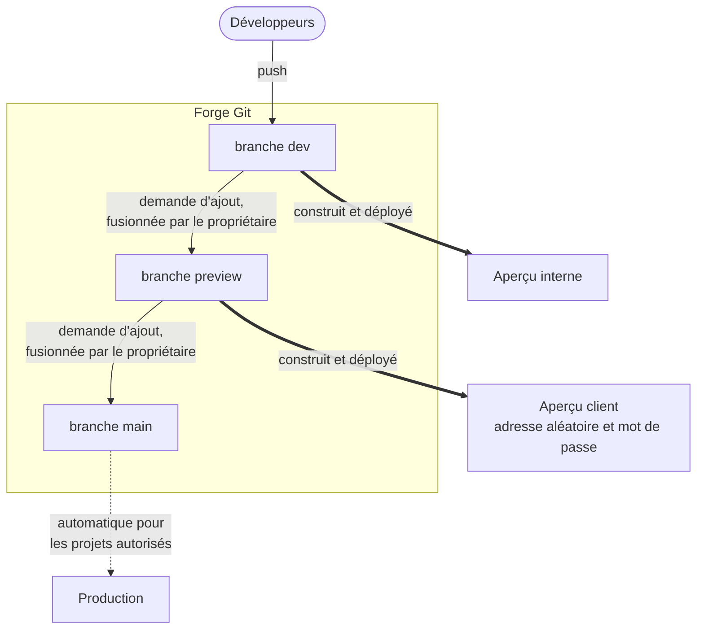
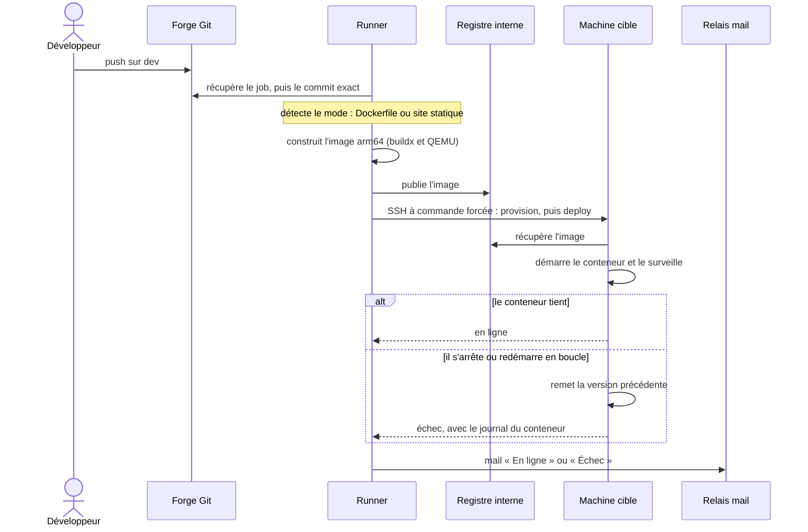

# CI/CD

[← Sommaire](../README.md)

Les sites sont construits et déployés par **Gitea Actions**. Un seul workflow, défini au niveau de l'organisation,
s'applique à tous ses dépôts, actuels et futurs : aucun projet n'a de fichier de pipeline à maintenir, et un dépôt est
déployable dès sa création.

Trois branches, trois destinations :

- **`dev`** : chaque push part en aperçu interne.
- **`preview`** : aperçu pour le client, à une adresse aléatoire protégée par mot de passe. Il expire après quelques
  jours sans nouveau déploiement.
- **`main`** : production. Le déploiement automatique est réservé aux projets explicitement autorisés ; les autres
  passent en production à la main.

## Un passage de la pipeline

Le mail d'échec indique l'étape en cause et si la version en ligne a été touchée (« Site intact » ou « À vérifier »),
avec la fin du journal.

## Le runner

- **Un seul runner**, enregistré au niveau de l'organisation, sur une machine de build dédiée : chaque job tourne dans
  un conteneur éphémère.
- **Docker sans root**, sous un compte dédié sans `sudo`.
- **Conteneurs de job bridés** : pas de mode privilégié, aucun dossier de l'hôte monté, mémoire, processeurs et nombre
  de processus limités, durée maximale.
- **Images arm64 construites sur x86_64** avec buildx et QEMU ; les images destinées aux clients sont construites
  sans réseau.

## Garde-fous

- **Le code du dépôt n'est jamais exécuté dans le conteneur du job** : il est seulement construit par BuildKit, ou
  envoyé tel quel. Aucune donnée du commit n'est insérée dans un script.
- **Un secret par étape** : chaque étape ne reçoit que le secret dont elle a besoin, et aucun n'apparaît dans les
  journaux.
- **Déploiement par relais SSH à commande forcée** : la clé du runner ne peut lancer que le script de déploiement de la
  cible, avec `sudo` limité à ce script ; les clés d'hôte des cibles sont épinglées.
- **Retour arrière automatique** sur la cible si la nouvelle version ne tient pas.
- **Branches protégées** : poussée et fusion vers `preview` et `main` réservées au propriétaire, poussée forcée
  interdite. Les règles sont posées automatiquement sur chaque nouveau dépôt.
- **Second verrou dans le workflow** : un déploiement de `preview` ou `main` est refusé si celui qui l'a déclenché n'est
  pas le propriétaire, même si une protection manquait.
- **Un seul conteneur par projet** : aucun fichier compose n'est appliqué, puisqu'il pourrait demander le mode
  privilégié ou monter le disque de l'hôte.

## Deux modes de construction

| Mode | Détecté quand | Résultat |
|---|---|---|
| `dockerfile` | le dépôt contient un Dockerfile | image construite à partir de ce Dockerfile |
| `static` | pas de Dockerfile, mais un `index.html` ou plusieurs maquettes | image nginx durcie générée par le workflow, avec une page de choix quand il y a plusieurs maquettes |

## Arrêter un aperçu

- **Bouton dans la forge** (workflow manuel réservé au propriétaire) : aperçu interne, client ou les deux ; arrêt
  simple ou suppression complète.
- **Expiration automatique** des aperçus clients restés sans nouveau déploiement.
