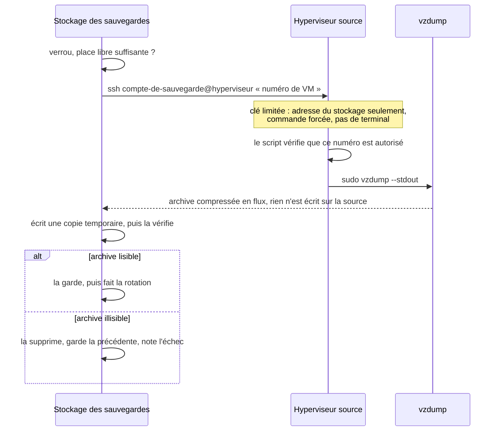

# Sauvegardes

[← Sommaire](../README.md)

**Les sauvegardes sont tirées, jamais poussées.** C'est le stockage des sauvegardes qui va chercher chaque copie. Les
machines sauvegardées ne détiennent aucune clé vers lui : une machine compromise ne peut ni lire, ni modifier, ni
effacer ses propres sauvegardes.

## Comment une copie est tirée

- **Côté source** : un compte dédié, sans mot de passe, dont la clé n'accepte que l'adresse du stockage (`restrict`,
  `from=`) et ne lance qu'un seul script (`command=`), avec `sudo` limité à ce script. Le script n'accepte que les
  numéros de VM prévus ; toute autre demande (`id`, `$(id)`, plusieurs numéros, un chemin…) est refusée.
- **Côté stockage** : une clé par source, clé d'hôte de la source épinglée, verrou contre les passages simultanés,
  marge de place exigée avant chaque copie.
- **Pas de copie temporaire sur la source** : l'archive arrive en flux, ce qui n'use ni ne remplit ses disques.
- **Une archive illisible n'efface jamais la précédente.**

## Bases de données critiques

Une copie de VM ou de conteneur entier ne suffit pas pour une base qui change souvent. Pour les services critiques, une
copie cohérente de la base (sauvegarde à chaud de SQLite, puis contrôle d'intégrité) est tirée plus souvent, sur le
même modèle : le compte de sauvegarde n'accepte que deux demandes, « base » et « conteneur ».

## Restaurer

Principe : une sauvegarde ne compte qu'une fois sa restauration essayée, sur une autre machine, base et données
comprises. Vérifier l'archive ne suffit pas.
