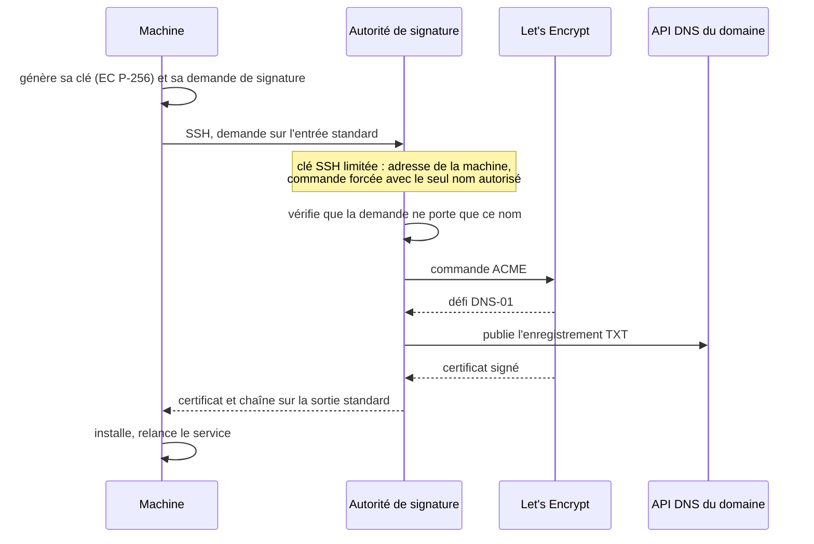
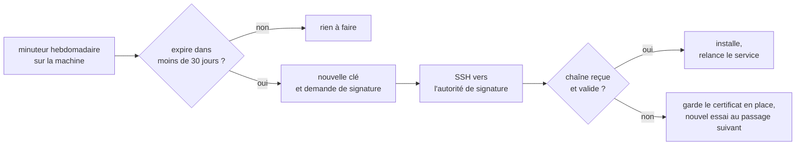

# Certificats

[← Sommaire](../README.md)

Les interfaces internes utilisent de vrais certificats Let's Encrypt, obtenus par défi DNS : aucune machine interne n'a
besoin d'être joignable depuis internet. **Une seule machine détient les jetons de l'API DNS**, l'autorité de
signature. Les autres lui envoient une demande de signature ; **la clé privée d'un certificat ne quitte jamais sa
machine**.

## Le relais de signature

- **Une clé SSH par machine** sur l'autorité de signature, avec `restrict`, `from=` (l'adresse de la machine) et
  `command=` (le script de signature et le nom exact autorisé) : une machine ne peut faire signer que son propre nom.
- **Pare-feu local** : l'autorité de signature n'accepte que les machines autorisées à faire signer.
- **Clé du certificat en EC P-256**, jamais Ed25519 : Let's Encrypt la refuse pour un certificat serveur. La clé SSH du
  transport, elle, peut rester en Ed25519 : ce sont deux clés sans rapport.
- **Sites publics** : le reverse proxy obtient et renouvelle lui-même leurs certificats, par défi HTTP.

## Renouvellement

Le renouvellement repasse par le même chemin, piloté par un minuteur sur la machine :

Chaque renouvellement produit une nouvelle clé : une clé compromise ne survit pas au certificat suivant.
