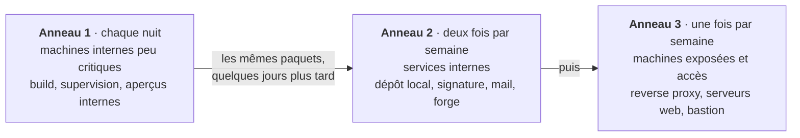
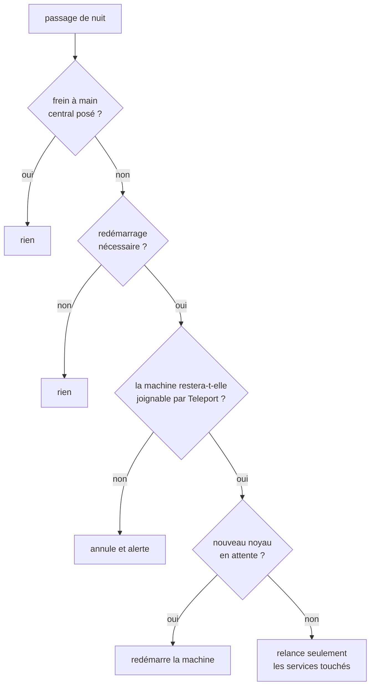
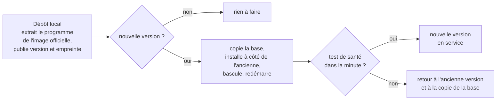

# Mises à jour

[← Sommaire](../README.md)

Les mises à jour sont automatiques, avec deux règles : **les correctifs de sécurité passent au plus vite**, et **le
reste avance par anneaux**, des machines les moins critiques aux plus exposées. Un problème apparaît ainsi d'abord là
où il coûte le moins.

## Les anneaux

## Le kit de mises à jour

Les machines reçoivent toutes le même kit (un script et quatre minuteurs systemd), installé depuis le dépôt local
après vérification de l'empreinte de chacun de ses fichiers.

| Passage | Rythme | Rôle |
|---|---|---|
| sécurité | plusieurs fois par jour | correctifs des origines de sécurité seulement ; ne redémarre rien |
| anneau | la nuit, les jours de l'anneau | toutes les mises à jour, en gardant les configurations locales |
| nuit | chaque nuit, un anneau après l'autre | redémarre la machine ou les services qui en ont besoin, si c'est sans risque |
| métriques | en continu | publie l'état de la machine pour la supervision |

Le passage de nuit ne redémarre jamais une machine à l'aveugle :

- **Vérification Teleport** : le service démarre avec la machine, le nom du bastion se résout à la bonne adresse, et
  cloud-init ne réécrira pas le fichier `hosts` au démarrage. Ce sont trois causes réelles de machines devenues
  injoignables après un redémarrage.
- **Frein à main** : un interrupteur central suspend tous les passages, ou un seul anneau.
- **Verrou commun** : deux passages ne tournent jamais en même temps sur une machine.
- **Agents de sécurité mis à jour à part** : Teleport, Wazuh et CrowdSec suivent leur propre rythme ; un agent Wazuh
  ne doit jamais dépasser la version de son serveur.
- **Raspberry Pi et ZFS** : le module ZFS est recompilé pour chaque nouveau noyau ; le redémarrage attend la fin de la
  compilation.

## Images de conteneurs

- **Un catalogue des versions autorisées**, tenu à jour automatiquement : il n'accepte qu'un correctif de la même
  branche, jamais une préversion ni un changement de version majeure. Les nouvelles branches majeures sont signalées
  une fois par mois, pour décision.
- **Images maison reconstruites sur place**, à partir de sources vérifiées (Traefik, nginx, pare-feu web).
- **Côté machines**, au rythme de leur anneau : la nouvelle version est appliquée, les réponses des services sont
  comparées avant et après, et **la version précédente revient seule** si quelque chose ne répond plus. Une version qui
  a échoué est bloquée sur cette machine et signalée.

## Exemple : un service installé nativement

Pour un service distribué seulement en image Docker mais installé sans Docker, le dépôt local extrait le programme de
l'image officielle ; le service se met ensuite à jour lui-même, avec retour arrière :

Les dernières versions et les dernières copies de la base restent sur place, pour revenir en arrière même plus tard.
