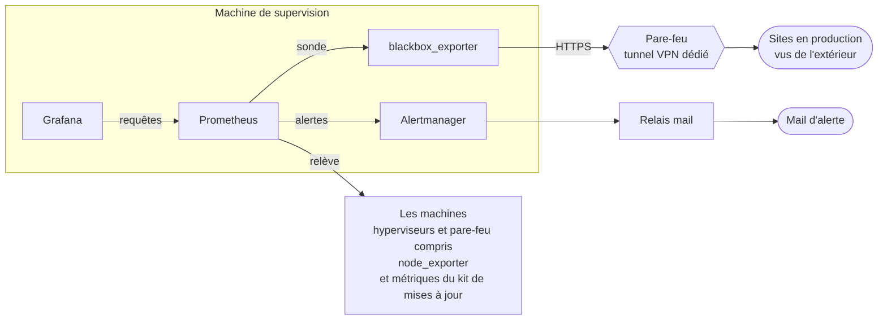

# Supervision

[← Sommaire](../README.md)

Deux outils, deux questions :

- **Prometheus** répond à « est-ce que tout tourne ? » : machines, services, mises à jour, sites vus de l'extérieur.
- **Wazuh** répond à « est-ce que quelqu'un fait quelque chose d'anormal ? » : intégrité des fichiers, journaux,
  vulnérabilités.

Les deux envoient leurs alertes par mail, à travers le relais interne.

## Prometheus, Alertmanager, Grafana

- **node_exporter sur les machines**, hyperviseurs et pare-feu compris, ouvert à la supervision. Les cibles sont
  rangées dans un fichier par machine : en ajouter une ne demande pas de toucher à la configuration principale.
- **Métriques du kit de mises à jour** : les machines publient leurs correctifs en attente, leur besoin de
  redémarrage, l'état de leur tunnel Teleport et de leurs agents de sécurité (voir [mises à jour](09-mises-a-jour.md)).
- **Sondes externes réelles** : blackbox_exporter interroge les sites en production à leur adresse publique, à travers
  un tunnel VPN dédié. Le pare-feu n'y envoie, par routage par politique, que ce flux précis : la sonde voit les sites
  comme un visiteur, sans que la supervision ait un accès internet général.
- **Grafana** : une vue d'ensemble (hyperviseurs et pare-feu, serveurs, sites en production, aperçus, sécurité) et un
  tableau des mises à jour.

## Alertes

| Famille | Exemples |
|---|---|
| Disponibilité | site injoignable de l'extérieur, tunnel de sonde coupé, machine injoignable |
| Accès | machine plus joignable par Teleport, redémarrage qui la rendrait injoignable |
| Intrusion | fichier-piège lu sur une machine exposée |
| Agents | Teleport, Wazuh ou CrowdSec arrêté |
| Mises à jour système | correctifs de sécurité en attente trop longtemps, redémarrage en attente, passage en échec ou absent |
| Mises à jour des conteneurs | retour arrière effectué ou en échec, passage absent |
| Frein à main | mises à jour suspendues depuis trop longtemps |

Une alerte qui dure est rappelée selon sa gravité : souvent si elle est critique, une fois par jour pour un
avertissement, rarement pour une information. Les nouvelles versions majeures d'images font l'objet d'un seul mail
récapitulatif par mois.

## Wazuh

Un serveur Wazuh et ses agents :

- **Intégrité des fichiers sensibles en temps réel** : toute modification déclenche une alerte envoyée par mail ; le
  contenu des fichiers n'est pas recopié dans les alertes, puisque certains contiennent des clés.
- **Détection des vulnérabilités** : les paquets de chaque machine sont comparés aux bases de CVE.
- **Journaux** des machines collectés et corrélés.

## Hyperviseurs

Les hyperviseurs envoient leurs propres notifications (sauvegardes, erreurs) par le même relais mail.
