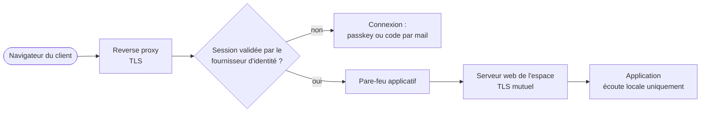
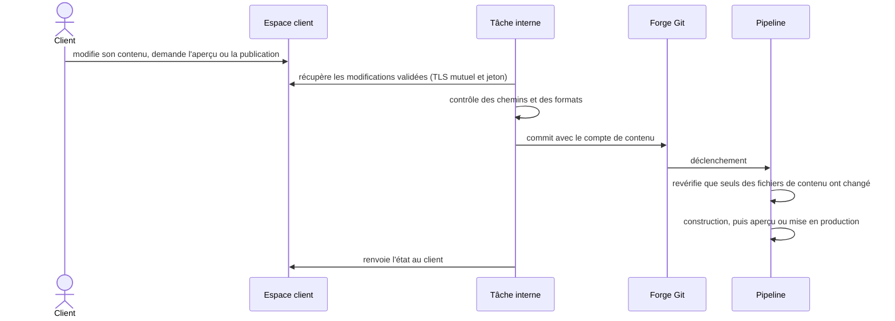

# Espace client

[← Sommaire](../README.md)

Les clients disposent d'un espace en ligne pour gérer leur site. C'est la partie la plus exposée de l'infrastructure :
elle est conçue pour qu'une compromission y reste sans conséquence sur le reste. L'espace ne détient aucun accès à la
forge Git, et il ne peut faire publier que du contenu.

## Le chemin d'une requête

- **Aucune page avant la connexion** : le reverse proxy fait valider la session par le fournisseur d'identité avant de
  laisser passer la moindre requête.
- **TLS mutuel** entre le reverse proxy et le serveur web de l'espace : une requête qui n'arrive pas par le bon chemin
  est refusée.
- **Application injoignable directement** : elle n'écoute que sur l'interface locale de sa machine.

## Connexion

L'application n'a pas de page de connexion propre : tout passe par le fournisseur d'identité, en OpenID (code
d'autorisation avec PKCE). Elle vérifie elle-même la signature du jeton, refuse les jetons non signés ou signés par un
secret partagé, et ne croit aucun en-tête d'identité ajouté en amont. Clés d'accès, session liée au réseau du client et
durcissement du fournisseur sont décrits dans la page [sécurité](04-securite.md).

La session de l'espace tient dans un cookie restreint au domaine exact (préfixe `__Host-`), avec les en-têtes de
sécurité habituels et un refus par défaut.

## Droits

Les droits sont portés par des **attributs de groupe** chez le fournisseur d'identité : un attribut ouvre l'accès à un
site précis, un autre le rôle d'administration. Ajouter un client revient à créer un groupe, sans toucher à
l'application ni la redéployer. Sans attribut reconnu, la réponse est un refus.

## L'application

- **Binaire Go statique**, sans dépendance externe, sur une machine dédiée de la zone exposée, séparée des sites.
- **Confinement systemd** : compte dédié, système de fichiers en lecture seule, aucun privilège, adresses réseau
  joignables listées une à une, mémoire et nombre de tâches plafonnés.
- **Secret par fichier** : le secret OpenID est fourni par systemd sous forme de fichier. S'il arrive par une variable
  d'environnement, l'application refuse de démarrer.
- **Tests d'attaque automatisés**, qui rejouent par exemple un jeton falsifié ou un algorithme de signature affaibli.

## Publication du contenu

Le circuit de publication est conçu pour que l'espace exposé n'écrive jamais lui-même dans la forge : c'est l'intérieur
qui vient chercher les modifications, comme pour les [sauvegardes](07-sauvegardes.md).

- **Contenu structuré** : le client remplit des formulaires (textes, listes, images), jamais du HTML. Le site affiche
  ces données avec ses propres composants, qui échappent le texte par défaut.
- **Canal interne dédié** : la tâche qui récupère les modifications tourne sur la machine de build. Le canal est en TLS
  mutuel, avec deux autorités de certification à usage unique dont les clés ont été détruites après signature, plus un
  jeton. Sur la machine de build, seul le compte temporaire de cette tâche peut joindre ce port : les conteneurs de la
  CI ne le peuvent pas.
- **Serrure de la forge** : le compte de contenu ne peut écrire que les fichiers de contenu du dépôt concerné, et sur
  aucun autre dépôt.
- **Double contrôle** : la pipeline refait la vérification de son côté. Une poussée du compte de contenu qui touche
  autre chose est refusée.
- **Même chemin que le reste** : l'aperçu et la mise en production passent par la [pipeline](06-ci-cd.md) habituelle,
  avec la liste d'autorisation, la version exacte et le retour arrière automatique.

Dans le pire des cas, un attaquant qui prendrait la main sur l'espace client ne pourrait faire publier que du contenu,
dans les formats autorisés : jamais de code, et aucun accès aux autres dépôts.
